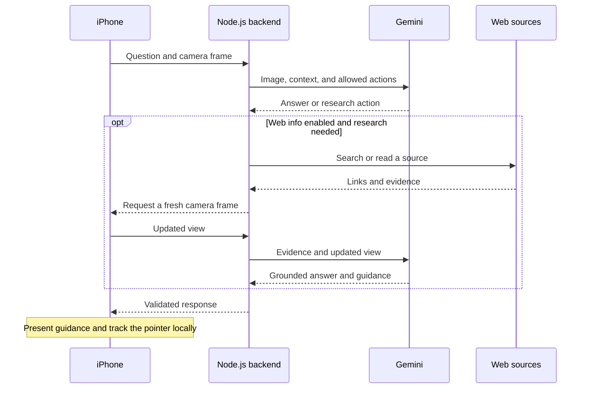

# CallYoDad

**Show what you see. Ask what you need. Find your next step.**

CallYoDad is an iPhone visual assistant that helps you understand and interact with the world in front of you. Keep your camera open, ask a question, and receive spoken guidance with visual pointers connecting the answer to what you are looking at.

Built for a hackathon with **Swift, SwiftUI, Apple Vision, Node.js, and the Gemini API**.

## Demo Video

[](https://www.youtube.com/shorts/3hVQmhwbsEw)


## Inspiration

Explaining a physical problem through a text box is awkward. You know which button, cable, or object you mean, but describing it can take longer than the task itself. Even a correct explanation can leave you wondering, “Which part is it talking about?”

We wanted asking an AI for help to feel closer to showing someone what you see. CallYoDad combines conversation, camera understanding, and visual guidance so users can move from an explanation to their next action.

## What it does

| Ask or do | How CallYoDad helps |
| --- | --- |
| “Where is the bottle?” | Marks a target over the camera preview, then uses local tracking as the camera moves. |
| “How do I open this?” | Explains the next action and can point to a relevant visible control or component. |
| Start a hands-on task | Breaks instructions into guided steps, with optional camera checks and a tools checklist. |
| “What does that tool look like?” | Looks up a reference picture; checklist items also have a picture button. |
| Explain a diagram or connection | Builds a narrated walkthrough on a captured image using labels, arrows, paths, shaded regions, and zooms. Pointing helps specify “this” and “that.” |
| “Where can I buy one?” | With web info enabled, retrieves product links and supporting information, including pricing when available. |
| Revisit an explanation | Saves visual walkthroughs on the phone for reopening and replay. |

Users can speak or type, optionally select an area, and view both sides of the conversation in resizable, translucent captions. Web information appears in an expandable overlay, keeping the camera at the center of the experience. No permanently selected object is needed.

## A short demo

1. **Find something.** Point the camera at a few everyday objects and ask, “Where is the bottle?” Move the camera to try the target tracking.
2. **Get help doing something.** Ask how to open or use a simple everyday object. Follow the explanation, then try guided steps and camera checks.
3. **Understand a diagram.** Show a diagram, point to the relevant areas, and ask how they connect. Follow the narrated annotations, then reopen the saved walkthrough.
4. **Go beyond the camera.** Turn on web info and ask for buying links or documentation. Expand the result overlay to inspect sources and pictures.

**For judges:** the app starts with clearly labelled **Demo responses** enabled. These are scripted examples for trying the interface. Actual camera understanding requires a connected Gemini backend and Demo responses switched off.

## How we built it

### Native camera and voice experience

The iOS app uses **SwiftUI** for the interface, **AVFoundation** for camera capture, and Apple's **Speech** framework for voice input. Replies can use native speech synthesis or optional Gemini-generated speech.

For object pointers, Gemini returns a location in the analyzed image. **Apple Vision** then tracks that region locally across camera frames. A short frame history helps align delayed model answers with the moving preview. Diagram explanations use a captured image, keeping annotations attached to the illustration during narration.

### An AI backend with explicit actions

Our **Node.js** backend sends selected camera frames and bounded conversation context to Gemini. It validates structured responses before the app acts on answers, visual annotations, clarification requests, or research actions. Separate endpoints support guided checks, reference pictures, speech, and focused diagram tracing.

The preview and tracking run on the phone; cloud understanding operates on captured frames. The user gets a continuous camera experience without continuously streaming video to the model.



### Information beyond the image

With web info enabled, the assistant can use **Serper** search results and read relevant sources when a question needs outside information. Ordinary visual questions can stay camera-only. Source cards preserve actual links rather than relying on the model to invent URLs.

Reference pictures have a separate lookup path: Serper image search when configured, with Wikipedia and Wikimedia fallbacks. Explicit picture requests can therefore access online sources independently of the web-info toggle.

| Layer | Technologies |
| --- | --- |
| iPhone app | Swift, SwiftUI, AVFoundation, Speech, Vision |
| Camera understanding | Gemini API with structured responses |
| Backend | Node.js built-in modules; no npm runtime dependencies |
| Research and pictures | Serper, source retrieval, Wikipedia/Wikimedia |
| Spoken output | Native iOS speech; optional Gemini TTS |

## Challenges we ran into

- **The camera moves while the model thinks.** A correct box on an old image can point at the wrong thing in the live view. We connected responses to their source frames and added frame replay and local tracking.
- **“This” and “that” need context.** We combined camera input with region selection and pointing information, while allowing clarification requests.
- **Different questions need different amounts of work.** Locating an object benefits from a compact response; explaining a diagram needs more detail. We introduced separate request paths and stage-level timing logs.
- **Search results need grounding.** We validate research actions and retain source links so users can inspect the information behind a response.
- **Voice and camera must cooperate.** Listening, interruptions, spoken replies, and app lifecycle changes require coordination. Audio behavior remains an area for device testing and refinement.

## What we're proud of

We connected camera understanding, voice, visual pointers, guided tasks, and web research in one native interface. We also extended the interaction beyond a spoken answer: diagrams become narrated visual walkthroughs users can save and replay.

Behind the interface, we added structured-response validation, bounded research workflows, per-user signing configuration, and automated backend tests to make a fast-moving hackathon project easier to develop together.

## What we learned

A useful visual assistant needs more than a capable model. Answers need to arrive at the right time, point at the right place, and leave room for users to interrupt or correct them. Measuring camera preparation, backend processing, and answer presentation separately helped us understand where the experience needed work.

## What's next

- Reduce latency with lighter requests and more on-device processing for common tasks.
- Improve audio-session reliability and interruption handling across devices.
- Evaluate localization and tracking under changing light, occlusion, and similar-looking objects.
- Make saved walkthroughs easier to organize and revisit.

CallYoDad is a hackathon prototype. Visual locations and task checks are AI estimates, and response time depends on the model, network, and provider availability. We have not established a production accuracy or latency benchmark.

## Try it locally

<details>
<summary><strong>Developer setup: iPhone app and backend</strong></summary>

### Requirements

- A Mac with Xcode and an iPhone running iOS 17 or later.
- Node.js 22.9 or later and Python 3 for the signing helper.
- A Gemini API key for live AI; an optional Serper key for web search.

### 1. Clone and configure

```sh
git clone https://github.com/codejam16/Father.git
cd Father
cp server/.env.example server/.env
```

Edit `server/.env`:

```dotenv
AI_MODE=gemini
HOST=0.0.0.0
PORT=8787
APP_TOKEN=replace-with-a-private-random-token-at-least-16-characters
GEMINI_API_KEY=your-gemini-api-key
# Optional web search:
# SERPER_API_KEY=your-serper-api-key
```

Keep API keys on the backend. The phone uses the connection token, not the Gemini key. The local `.env` is ignored by Git. See [all backend options](server/.env.example) for model, image-detail, and voice settings.

### 2. Configure personal signing once

From the repository root, replace these placeholders with your Apple team ID and a unique bundle identifier:

```sh
python3 scripts/configure-signing.py --team YOURTEAMID --bundle-id dev.yourname.tasklens
open ios/TaskLens.xcodeproj
```

The helper saves your values in the Git-ignored `ios/Config/Signing.local.xcconfig`. Each teammate keeps their settings across pulls. See [personal signing setup](docs/SIGNING.md).

In Xcode, select the **CallYoDad** scheme and your connected iPhone, then press **Run**. Accept camera, microphone, Speech, and Local Network permissions when requested.

### 3. Start and connect

```sh
cd server
npm start
```

Keep the backend running and put the Mac and iPhone on the same reachable network. On the Mac, this usually prints the Wi-Fi IP:

```sh
ipconfig getifaddr en0
```

In the app's connection settings:

| Setting | Value |
| --- | --- |
| Demo responses | Off |
| Backend URL | `http://YOUR_MAC_IP:8787` |
| Connection token | Your `APP_TOKEN` value |

The `/health` endpoint is a connectivity check, not the app interface. Leave `/health` off the URL in app settings.

### Controls and data flow

- **Captions:** toggle the speech bubble and drag the handle to resize.
- **Web info:** permits research for questions needing outside information; it does not force a search every time.
- **Selection:** optionally attach a region to a question.
- **Guided steps:** camera checks can generate additional AI requests.
- **Reference pictures:** explicit requests can perform online lookups separately from web research.
- **Voice:** native speech works without enabling Gemini voice.

In live mode, submitted frames and question context go through the backend to the AI provider. Saved walkthroughs remain on the phone. Demo answers do not call Gemini or Serper, but requesting an online reference picture is a separate network action.

</details>

## Tests and technical details

```sh
npm test --prefix server
python3 scripts/test-signing.py
```

Backend tests use mocked providers to check application behavior and validation. They do not establish live model accuracy or speed. Native builds and camera/audio behavior require Xcode and device testing.

- [API contract](docs/API.md)
- [Latency investigation](docs/LATENCY.md)
- [Personal signing setup](docs/SIGNING.md)
- [Device checks](docs/DEVICE_CHECKS.md)

```text
ios/TaskLens/    Native camera, voice, overlays, and walkthroughs
server/src/     AI adapters, research, validation, and task workflow
server/test/    Backend tests with mocked providers
scripts/        Signing configuration and project helpers
docs/           API details and development checks
```
